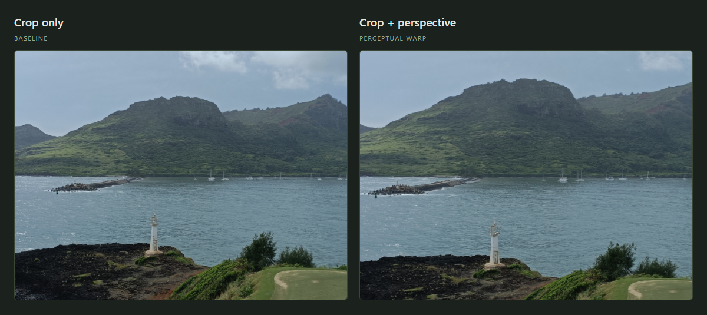
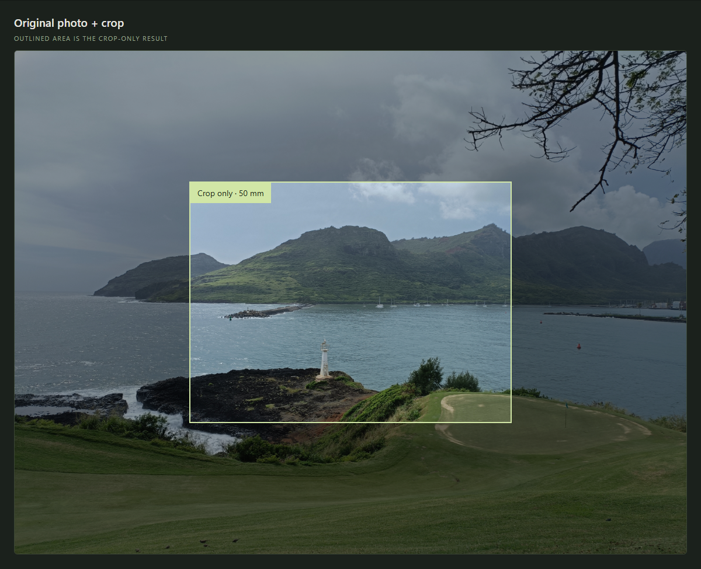

# Vistas As Seen

Help artists turn landscape photos into painting references that better express the scale they experienced on location. Try **fixed-position camera rotation** and **depth-aware enhancement**, separately or together, keeping the original in view.

## Sponsorship

**This project is sponsored by Crossborder Art & Media LLC.**

Licensed under [Apache-2.0](LICENSE), with sponsorship attribution in [NOTICE](NOTICE). Redistributed derivative works must preserve applicable notices as specified in Section 4(d); a visible app credit is welcome but not required. Third-party dependencies and model weights retain their own licenses.

Photographers and painters have long discussed distant scenery losing prominence in photos and the limits of photographic references. See [Michael Frye](https://www.michaelfrye.com/2015/03/29/lenses-perspective/), [Aaron Hertzmann](https://pmc.ncbi.nlm.nih.gov/articles/PMC11055503/), and [Koo Schadler](https://kooschadler.com/techniques/photo-references.pdf). This POC explores whether controlled depth-based adjustment makes those references more useful.

## See the difference

**Crop only (left) · Depth-enhanced (right)** — actual app output from the [sample photo](samples/IMG20240105123302.jpg).



**Original with the shared crop outlined:**



Depth comparison settings: 50 mm target, 22% emphasis, centered crop and anchor, Small model. This capture used GPU inference and an assumed 24 mm source focal length. The app now opens with camera rotation and depth enhancement enabled. [Full settings](docs/showcase/settings.json).

## Run

Requires Node.js 22.18+ or Node 24 and a current desktop browser.

```sh
npm install
npm run dev
```

Open [localhost:5173](http://127.0.0.1:5173).

## Try it

1. Import a JPEG, PNG, or WebP (HEIC where supported). Check the source focal length; missing EXIF defaults to 24 mm.
2. Choose the target focal length and drag the target on the original preview. **Camera rotation** and **Depth enhancement** are enabled by default. The outline shows the baseline frame without depth. Movement stops at the image boundary, preserving the selected focal length. Arrow keys fine-tune.
3. The left result always shows the same framing without depth: rotation-only when camera rotation is enabled, otherwise crop-only.
4. Choose **Small**, **Base**, or **Large**, and estimate depth. Leave **Camera rotation** enabled to combine them, or turn it off for crop + depth. GPU is preferred, with automatic CPU fallback; photos stay local. The baseline updates automatically with the camera-rotation setting. Adjust emphasis and place the anchor within the rotated result. Moving the frame reuses the existing depth estimate.
5. Compare without labels, record your preference, and export either PNG or an edit recipe. Save outputs before refreshing; sessions are not persisted.

## POC limits

- Working images and exports are capped at **1600 px** on the long edge; uploads at 40 MB.
- Camera rotation assumes a rectilinear image, a centered principal point, and diagonal 35mm-equivalent focal lengths. It uses no depth, translation, or generated fill; it does not correct residual lens distortion.
- Combined mode aligns depth with the rotated view, applies the artistic warp there, and samples the original photo once. Sampling stays inside the rotated footprint; zero emphasis matches rotation-only. The outline shows the view before depth enhancement.
- Enhancement is an artistic warp. It can bend straight structures or stretch depth boundaries; it is not physical camera reconstruction.
- Depth Anything V2 Small uses Apache-2.0 weights. **Base and Large use noncommercial CC-BY-NC-4.0 weights** and require more memory and download time. Full inference for these larger models still needs validation on target hardware.
- Exported PNGs omit source metadata. Recipes are export-only, not reloadable projects.

See the [design document](perceptual_perspective_design.md) for the broader geometry, architecture, and evaluation plan. This browser-only POC implements crop, fixed-position rotation, and perceptual enhancement.

## Development

```sh
npm run build
npm test
```

With the app running and Windows Chrome installed:

- `node tests/browser.mjs` — browser checks with real inference; set `FORCE_CPU=1` to check CPU fallback.
- `node tests/rotation-browser.mjs` — camera rotation, frame bounds, PNG/recipe exports, and responsive layout; no model download.
- `node scripts/create-showcase.mjs` — regenerate the README images using depth-comparison defaults.
